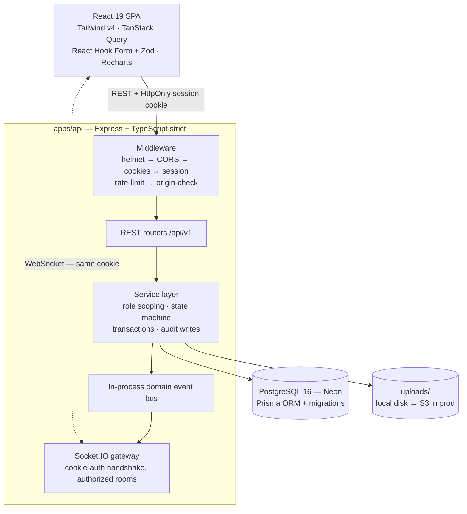

# HelpDesk Pro — Full-Stack Customer Support Platform

[](https://helpdesk-pro-krzg.onrender.com)
[](https://github.com/pushpavallimolleti-web/helpdesk-pro/actions)
[](https://www.typescriptlang.org)
[](LICENSE)

A production-style support ticketing SaaS — customers open tickets, agents triage
and resolve them in realtime, admins manage the operation. Built to demonstrate
**real engineering**: server-enforced RBAC, a ticket state machine, an SLA engine
with a scheduled sweeper, Socket.IO realtime, an append-only audit trail, and a
typed contract layer shared between client and server.

> ### ▶ [Live Demo](https://helpdesk-pro-krzg.onrender.com) — click **"Try as Customer / Agent / Admin"**
> _Free tier — first load may take ~30s to wake._

| Demo role | Email | Password |
|---|---|---|
| Customer | `customer@helpdesk.dev` | `Demo!Passw0rd` |
| Agent | `agent@helpdesk.dev` | `Demo!Passw0rd` |
| Admin | `admin@helpdesk.dev` | `Demo!Passw0rd` |

---

## Screenshots

| Landing + one-click demo | Agent queue — priority cards, grouped list |
|---|---|
|  |  |

| Ticket detail — chat thread + manage panel | Admin analytics |
|---|---|
|  |  |

## Architecture



`packages/shared` carries **only wire contracts** — DTOs, enums, Zod schemas,
socket event names — imported by both apps so the API surface can never drift.

## What makes this more than a CRUD app

- **Session auth done right** — opaque tokens in `HttpOnly` cookies, SHA-256
  hashed at rest, revocable, sliding renewal. No JWT, nothing JS-readable.
- **Authorization in the query layer** — `CUSTOMER / AGENT / ADMIN` scoping is
  server-side on every route. Cross-customer access returns **404** — existence
  never leaks. Role/status changes revoke sessions immediately.
- **Internal notes can't leak** — filtered in the DB query *and* masked in the
  serializer; never emitted over REST or sockets to customers. (Tested.)
- **Ticket state machine** — `OPEN → IN_PROGRESS ⇄ WAITING_FOR_CUSTOMER →
  RESOLVED → CLOSED` + 14-day reopen. Invalid transitions → `409
  FORBIDDEN_TRANSITION`. Assignment auto-starts work; customer replies flip
  waiting tickets back to active.
- **SLA engine** — per-priority response/resolution targets snapshotted at
  creation; a scheduled sweeper warns assignees once before/after breach;
  targets are admin-editable at runtime.
- **Realtime without leaks** — Socket.IO events carry **ids only**; authorized
  clients refetch content over REST. Cookie-auth handshake + scoped rooms.
- **Append-only audit trail** — every sensitive mutation (status, assignment,
  role changes, attachments, SLA config) written inside the same transaction.
- **Attachments** — MIME allowlist + size cap, authorized streaming downloads,
  uploader/admin delete.
- **Fuzzy search** — `pg_trgm` trigram index on ticket subject.
- **Uniform errors** — one `{ error: { code, message, details? } }` envelope,
  typed `ERROR_CODES` shared with the client.

## Tech stack

| Layer | Choices |
|---|---|
| **Web** | React 19, Vite, Tailwind v4, React Router, TanStack Query, RHF + Zod, Recharts, socket.io-client |
| **API** | Express 4, TypeScript strict, Prisma 6, bcryptjs, pino-http, Socket.IO, multer, swagger-ui |
| **Data** | PostgreSQL 16 (Neon in prod), Prisma migrations, 9 models |
| **Tooling** | npm workspaces, Vitest + Supertest, React Testing Library, Playwright, ESLint/Prettier, tsup |
| **Infra** | Render (single service: API serves built SPA), Neon managed Postgres, GitHub Actions CI |

## Testing — 32 cases, all green

- **`apps/api/tests/`** — 17 Supertest integration cases on a dedicated
  `helpdesk_test` DB: auth matrix, customer isolation, transition matrix,
  **internal-note secrecy**, notifications, filters, reopen/close flows.
- **`apps/web/src/**.test.tsx`** — 10 RTL + util cases.
- **`e2e/`** — 5 Playwright specs: landing → one-click demo login → role
  journeys → reply → route guards.

```bash
npm test          # API + web suites
npm run test:e2e  # Playwright (dev servers must be running)
```

## Quickstart

```bash
git clone https://github.com/pushpavallimolleti-web/helpdesk-pro && cd helpdesk-pro
npm install
cp .env.example apps/api/.env       # set DATABASE_URL + SESSION_SECRET
docker compose up -d postgres       # or any Postgres 16
cd apps/api && npx prisma migrate deploy && npm run db:seed && cd ../..
npm run dev:api                     # → :4000  REST + Socket.IO + /api/docs
npm run dev:web                     # → :5173  Vite dev server (proxied API)
```

**API docs:** `localhost:4000/api/docs` (Swagger UI) · spec at `/api/docs.json`

## Repo layout

```
apps/web/src        React app — pages/, features/ (tickets, auth), components/
apps/api/src        modules/ (auth, tickets, comments, attachments, categories,
                    users, notifications, sla, audit, analytics), middleware/,
                    sockets/, events/, jobs/ (sla-sweep), openapi/, tests/
packages/shared/src enums, dto, schemas (zod), events — wire contract only
apps/api/prisma     schema (9 models), migrations, 62-ticket demo seed
docs/               architecture, decisions (ADRs), deployment, screenshots, status
e2e/                Playwright demo specs        .github/workflows/ci.yml
render.yaml         Render blueprint (one service: API + static SPA)
```

## Docs

- [`docs/architecture.md`](docs/architecture.md) — full system design
- [`docs/decisions.md`](docs/decisions.md) — **ADRs**: session vs JWT, event-bus
  pattern, SLA model, what's deliberately out of scope (and why)
- [`docs/deployment.md`](docs/deployment.md) — env contract, prod checklist, Docker
- [`docs/implementation-status.md`](docs/implementation-status.md) — live state tracker

## Roadmap (documented, not stubbed)

Password reset (needs real email delivery) · presigned S3 uploads + AV scan ·
canned responses · email-to-ticket · business-hours SLA · Redis socket adapter
for multi-instance · SSO/2FA.

---

**License:** MIT · _Built to be explained — every architectural choice has an ADR._
